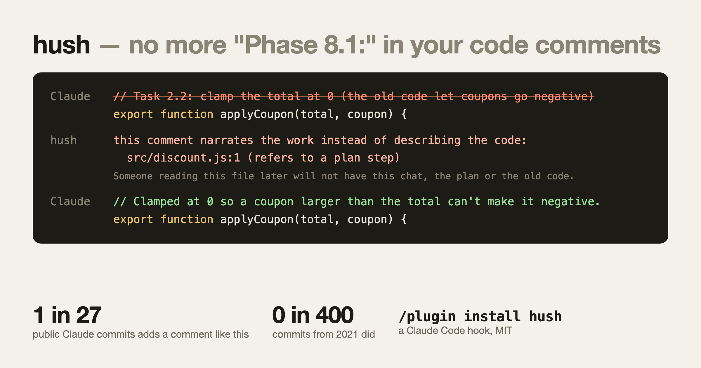

# hush

**Stop your coding agent narrating its plan in your code comments.**



In long sessions, coding agents leave comments written for the chat, not for the code:

```js
// Phase 8.4: the single list of the home screen
// GMN: the location picker lists the connection's locations (Task 7).
// The old code wrapped a parse failure; CompactObject works on
```

Six months later, nobody knows what Phase 8.4 was. The old code is gone.

**About 1 public Claude commit in 27 adds a comment like these. We found none in 400 commits from 2021.** The [study](study/README.md) has the method and the numbers.

hush is a Claude Code hook. Right after Claude edits a file, hush checks the comments it just added. If one narrates the work, Claude is told why and rewrites it in the same turn. Comments that were already in the file are never touched.

## Install

In Claude Code:

```
/plugin marketplace add openyard-cloud/hush
/plugin install hush@hush
```

Without the plugin system, run this in your project (or add `--user` for every project):

```bash
npx github:openyard-cloud/hush init
```

Start a new session after either one. Node 18 or newer, no dependencies, nothing leaves your computer.

## What it catches

| Kind | Example |
|---|---|
| A step of the agent's plan | `(Task 7)`, `Phase 8.1:`, `Task 12 —`, `per the plan` |
| The code that is gone | `the old code…`, `it used to…`, `was previously…`, `before this fix` |
| The edit itself | `Now uses…`, `Moved to…`, `Renamed from…`, `Fixed:`, `NEW:` |
| The chat | `as requested`, `you asked for…`, `per our discussion` |

Comments that explain the code pass, even when they use the same words:

```js
// Retry once: the API drops the first request after idle.
// Phase 1: B votes yes and holds its write lock until the decision.
// When the user asked to delete their account, pending bets are refunded.
```

The rules favour precision over recall. A hook that interrupts on good comments gets uninstalled, so hush misses some narration rather than flagging good comments. It reads `//`, `/* */`, `#` and `--` comments and Python docstrings: JavaScript, TypeScript, Python, Go, Rust, Java, Kotlin, Swift, C, C++, C#, Ruby, PHP, shell, SQL, Lua and more. Comment markers inside strings are not mistaken for comments, and Markdown is ignored.

If a comment is flagged by mistake, add `hush-ignore` to it. To turn hush off for one session, set `HUSH_OFF=1`.

## In CI and in other agents

For Codex, Cursor or any other agent, or a teammate's pull request, hush checks the diff:

```bash
npx github:openyard-cloud/hush check              # comments added since the last commit
npx github:openyard-cloud/hush check --staged     # for a pre-commit hook
npx github:openyard-cloud/hush check --base main  # everything this branch adds
npx github:openyard-cloud/hush check --all        # every comment already in the repo
```

As a GitHub Action, it shows each finding on its line in the pull request:

```yaml
on: pull_request
jobs:
  hush:
    runs-on: ubuntu-latest
    steps:
      - uses: actions/checkout@v4
        with:
          fetch-depth: 0
      - uses: openyard-cloud/hush@main
```

Set `fail: "false"` to report without failing the check.

## How the hook works

hush runs as a `PostToolUse` hook on `Edit`, `MultiEdit` and `Write`. Claude Code passes it the patch of each edit. hush reads only the `+` lines, finds the comments in them, and checks each one against the rules in [`src/detect.mjs`](src/detect.mjs).

When a comment matches, hush exits with code 2. Claude Code then shows Claude this:

```
hush: this comment you just added narrates the work instead of describing the code:
  src/discount.js:1 (refers to a plan step): Task 2.2: clamp the total at 0 (the old code let coupons go negative)

Someone reading this file later will not have this chat, the plan or the old code. Rewrite each one
to say only what the code does now or why it is this way, with no mention of tasks, phases, steps,
the user, or what changed. If the code already says it, delete the comment. Change nothing else.
```

If the hook itself fails, for example on a payload it cannot read, it exits 0, so the agent is never blocked by a hush bug.

## Why a hook and not a CLAUDE.md rule

People in [anthropics/claude-code#65961](https://github.com/anthropics/claude-code/issues/65961) report that rules in CLAUDE.md, in memory and in skills all get ignored. A rule is a request, and over a long session it competes with everything else in context. A hook runs on every edit, so nothing depends on Claude remembering a rule.

## License

MIT
